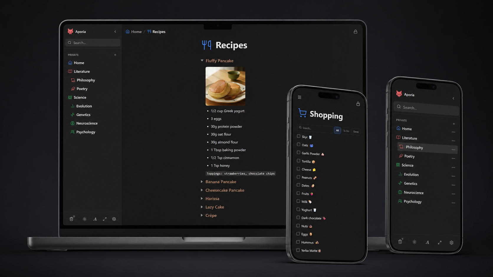

# Aporia 📝

> A minimalist, debloated Notion alternative for personal knowledge management. Self-hosted, fast, and private.

[](https://aporia-notes.vercel.app/)
[](https://svelte.dev)
[](https://www.typescriptlang.org)
[](https://www.docker.com)
[](LICENSE)

---

## 💡 What is Aporia?

**Aporia** is a minimalist, debloated Notion alternative designed for personal knowledge management.

Built for speed, clarity, and simplicity, Aporia combines modern block-based editing with a **clean, lightweight, and distraction-free interface**. It strips away unnecessary feature bloat so you can focus entirely on thinking, writing, and organizing your thoughts.

* ⚡ **Lightning-Fast & Responsive:** Powered by Svelte 5 and TipTap for instant page loads and fluid, effortless editing.
* 🎯 **Clean & Distraction-Free:** A sleek, uncluttered UI focused purely on your content, tasks, and ideas.
* 🔒 **Self-Hosted & Private:** Run Aporia on a server you control. Its SQLite database stays with your instance, which you can access from a browser or the Android app.

---

<!-- APP SHOWCASE -->
<div align="center">
  <br />
  
  
  <br />
</div>

---

## 🚀 Live Demo

Try Aporia directly in your browser: **[aporia-notes.vercel.app](https://aporia-notes.vercel.app/)**

> **Note for Demo Visitors:**  
> The public Vercel demo opens without a login. It is a shared, disposable workspace: changes may be visible to other visitors and can reset at any time. Do not add private or sensitive information.

---

## ✨ Features

- ✍️ **Block-Based Editor:** Rich-text editing powered by TipTap with support for headings, code blocks, task lists, tables, callouts, and inline styling.
- ⚡ **Instant Full-Text Search:** Powered by SQLite FTS5 for lightning-fast search across all titles and page contents.
- 🔒 **Self-Hosted:** Aporia runs on a server you control. Your browser and Android app connect to that instance, where your workspace data is stored.
- 📥 **Notion Import & Data Backup:** Easily export/import your workspace and import from Notion.
- 🎨 **Svelte 5 & Runes:** Built on Svelte 5 for top-tier performance and fine-grained reactivity.
- 🐳 **Production Ready:** Ships with a multi-stage Dockerfile and Docker Compose configurations.

For personal AI assistant access, see [the MCP connection guide](docs/mcp.md). It covers the private bearer key, the Hermes container, and desktop Codex.

### Android app

For a better phone experience, install the [Aporia Android APK](https://github.com/Kinanqazan/Aporia/releases/latest/download/Aporia.apk). On first launch, enter the HTTPS address of your self-hosted Aporia server. The APK is a client for your server; it does not include the server or its database. See [the Android guide](android/README.md) for installation, server connection, and build details.

---

## 🛠️ Tech Stack

| Component | Technology |
| :--- | :--- |
| **Framework** | [SvelteKit](https://kit.svelte.dev/) + [Svelte 5](https://svelte.dev/) |
| **Editor** | [TipTap 3](https://tiptap.dev/) |
| **Database & ORM** | [SQLite](https://sqlite.org/) + [Drizzle ORM](https://orm.drizzle.team/) |
| **Bundler** | [Vite 8](https://vitejs.dev/) |
| **Deployment** | Docker / GHCR (`adapter-node`) / Vercel (`adapter-vercel`) |

---

## 🚀 Self-Hosting

You need a Linux server with:

- [Docker Engine and Docker Compose](https://docs.docker.com/engine/install/) installed and running. Your account must be able to run `docker compose` (otherwise run the Docker commands below with `sudo`).
- Port 3001 available on the server. The Compose file publishes it on all interfaces, so restrict external access to port 3001 using your provider's firewall or Docker-compatible firewall rules. Docker-published ports can bypass ordinary host firewall rules; see [Docker's firewall guidance](https://docs.docker.com/engine/network/packet-filtering-firewalls/).

For remote access, use an HTTPS reverse proxy of your choice and an address that your devices can reach. The Android app requires HTTPS. The optional Caddy example below uses a public domain pointing to your server and requires ports 80 and 443 to be reachable from the internet.

### 1. Create the Compose file

Create a directory for Aporia and its data:

```sh
mkdir -p ~/aporia/config/aporia
cd ~/aporia
sudo chown -R 1000:1000 config/aporia
```

Create a file named `docker-compose.yml` in this directory and paste in the following. Save the file before continuing:

```yaml
services:
  aporia:
    image: ${APORIA_IMAGE:-ghcr.io/kinanqazan/aporia}:latest
    container_name: aporia
    restart: unless-stopped
    ports:
      - "3001:3000"
    environment:
      NODE_ENV: production
      HOST: 0.0.0.0
      PORT: 3000
      BODY_SIZE_LIMIT: 60M
      DATABASE_URL: /app/data/app.db
      UPLOAD_DIR: /app/data/uploads
      # Optional: only needed if you want to enable MCP.
      APORIA_MCP_ENABLED: ${APORIA_MCP_ENABLED:-false}
      APORIA_MCP_TOKEN: ${APORIA_MCP_TOKEN:-}
      APORIA_MCP_ALLOWED_ORIGINS: ${APORIA_MCP_ALLOWED_ORIGINS:-}
    volumes:
      - ./config/aporia:/app/data
```

### 2. Start Aporia

```sh
docker compose up -d
```

The database and uploaded files are stored in `config/aporia`; keep backups of your workspace. MCP is disabled by default; see [the MCP guide](docs/mcp.md) if you want to enable it.

### 3. Configure HTTPS

Configure your preferred reverse proxy to serve HTTPS and forward requests to Aporia on port `3001`, preserving the original host header. The exact upstream address depends on where the proxy runs. For a proxy running directly on the same server, use `127.0.0.1:3001`. For a proxy in a container, use the host's reachable address or connect both containers to a shared Docker network and use `aporia:3000`.

For example, if you use [Caddy](https://caddyserver.com/docs/install) as a system service on the same server, point your domain's DNS record to the server and allow ports 80 and 443 through your router and firewall. Edit `/etc/caddy/Caddyfile` and add this site block, replacing `aporia.example.com` with your domain. Keep any existing sites in the file:

```caddy
aporia.example.com {
    reverse_proxy 127.0.0.1:3001
}
```

Save the file, then validate it and reload Caddy (adjust the path and service commands if your installation differs):

```sh
sudo caddy validate --config /etc/caddy/Caddyfile
sudo systemctl reload caddy
```

Open your HTTPS address and immediately create your username and password. Account setup closes after the first account is created. Enter the same HTTPS address in the Android app.

To update Aporia later, run `docker compose pull` and `docker compose up -d` from the same directory.

---

## 📄 License

Released under the [MIT License](LICENSE).
