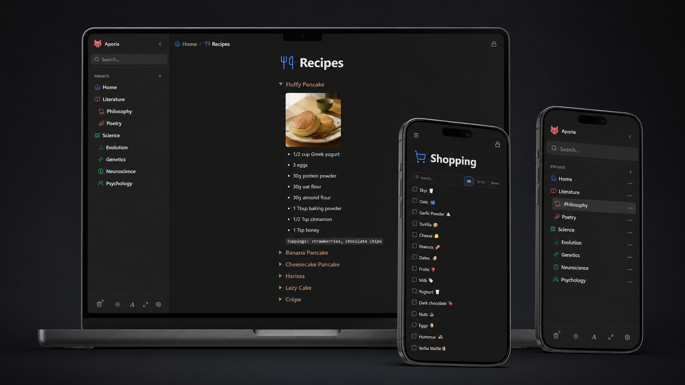

# Aporia 📝

> A minimalist, debloated Notion alternative for personal knowledge management. Self-hosted, fast, and private.

[](https://aporia-notes.vercel.app/)
[](https://svelte.dev)
[](https://www.typescriptlang.org)
[](https://www.docker.com)
[](LICENSE)

---

## 💡 What is Aporia?

**Aporia** is a minimalist, debloated Notion alternative designed for personal knowledge management.

Built for speed, clarity, and simplicity, Aporia combines modern block-based editing with a **clean, lightweight, and distraction-free interface**. It strips away unnecessary feature bloat so you can focus entirely on thinking, writing, and organizing your thoughts.

* ⚡ **Lightning-Fast & Responsive:** Powered by Svelte 5 and TipTap for instant page loads and fluid, effortless editing.
* 🎯 **Clean & Distraction-Free:** A sleek, uncluttered UI focused purely on your content, tasks, and ideas.
* 🔒 **Self-Hosted & Private:** Run Aporia on a server you control. Its SQLite database stays with your instance, which you can access from a browser or the Android app.

---

<!-- APP SHOWCASE -->
<div align="center">
  <br />
  
  
  <br />
</div>

---

## 🚀 Live Demo

Try Aporia directly in your browser: **[aporia-notes.vercel.app](https://aporia-notes.vercel.app/)**

> **Note for Demo Visitors:**  
> The public Vercel demo opens without a login. It is a shared, disposable workspace: changes may be visible to other visitors and can reset at any time. Do not add private or sensitive information.

---

## ✨ Features

- ✍️ **Block-Based Editor:** Rich-text editing powered by TipTap with support for headings, code blocks, task lists, tables, callouts, and inline styling.
- ⚡ **Instant Full-Text Search:** Powered by SQLite FTS5 for lightning-fast search across all titles and page contents.
- 🔒 **Self-Hosted:** Aporia runs on a server you control. Your browser and Android app connect to that instance, where your workspace data is stored.
- 📥 **Notion Import & Data Backup:** Easily export/import your workspace and import from Notion.
- 🎨 **Svelte 5 & Runes:** Built on Svelte 5 for top-tier performance and fine-grained reactivity.
- 🐳 **Production Ready:** Ships with a multi-stage Dockerfile and Docker Compose configurations.

For personal AI assistant access, see [the MCP connection guide](docs/mcp.md). It covers the private bearer key, the Hermes container, and desktop Codex.

### Android app

For a better phone experience, install the [Aporia Android APK](https://github.com/Kinanqazan/Aporia/releases/latest/download/Aporia.apk). On first launch, enter the HTTPS address of your self-hosted Aporia server. The APK is a client for your server; it does not include the server or its database. See [the Android guide](android/README.md) for installation, server connection, and build details.

---

## 🛠️ Tech Stack

| Component | Technology |
| :--- | :--- |
| **Framework** | [SvelteKit](https://kit.svelte.dev/) + [Svelte 5](https://svelte.dev/) |
| **Editor** | [TipTap 3](https://tiptap.dev/) |
| **Database & ORM** | [SQLite](https://sqlite.org/) + [Drizzle ORM](https://orm.drizzle.team/) |
| **Bundler** | [Vite 8](https://vitejs.dev/) |
| **Deployment** | Docker / GHCR (`adapter-node`) / Vercel (`adapter-vercel`) |

---

## 🚀 Self-Hosting & Deployment

### 1. Create a deployment directory
On the Docker host, create a directory for Aporia and its persistent data:

```sh
mkdir -p /opt/aporia/config/aporia
sudo chown -R 1000:1000 /opt/aporia/config/aporia
cd /opt/aporia
```

### 2. Create `docker-compose.yml`
Create `/opt/aporia/docker-compose.yml` with the following contents:

```yaml
services:
  aporia:
    image: ghcr.io/kinanqazan/aporia:latest
    container_name: aporia
    restart: unless-stopped
    ports:
      - "127.0.0.1:3001:3000"
    environment:
      NODE_ENV: production
      HOST: 0.0.0.0
      PORT: 3000
      DATABASE_URL: /app/data/app.db
    volumes:
      - ./config/aporia:/app/data
```

### 3. Authenticate to GHCR (if the image is private)
```sh
docker login ghcr.io
```

Skip this step if the published image is public.

### 4. Start Aporia
```sh
docker compose pull
docker compose up -d
```

Check status and logs:
```sh
docker compose ps
docker compose logs -f aporia
```

The container listens on `127.0.0.1:3001` on the Docker host. Configure the HTTPS reverse proxy in the next step before connecting from another device.

### 5. Configure HTTPS with Caddy Reverse Proxy
Add the following site block to your `Caddyfile`:

```caddy
aporia.example.com {
    reverse_proxy 127.0.0.1:3001
}
```

Reload Caddy:
```sh
caddy validate --config /etc/caddy/Caddyfile
systemctl reload caddy
```

Open `https://aporia.example.com` in a browser or enter that address in the Android app. The phone must be able to reach the hostname, and the Android app requires HTTPS. On the first visit, create the username and password for your private workspace. Account setup closes after the first account is created.

---

## 💻 Local Development

1. **Clone the repository:**
   ```sh
   git clone https://github.com/kinanqazan/aporia.git
   cd aporia
   ```

2. **Install dependencies:**
   ```sh
   npm install
   ```

3. **Start development server:**
   ```sh
   npm run dev
   ```

4. **Run tests:**
   ```sh
   npm run test
   ```

---

## 📄 License

Released under the [MIT License](LICENSE).
